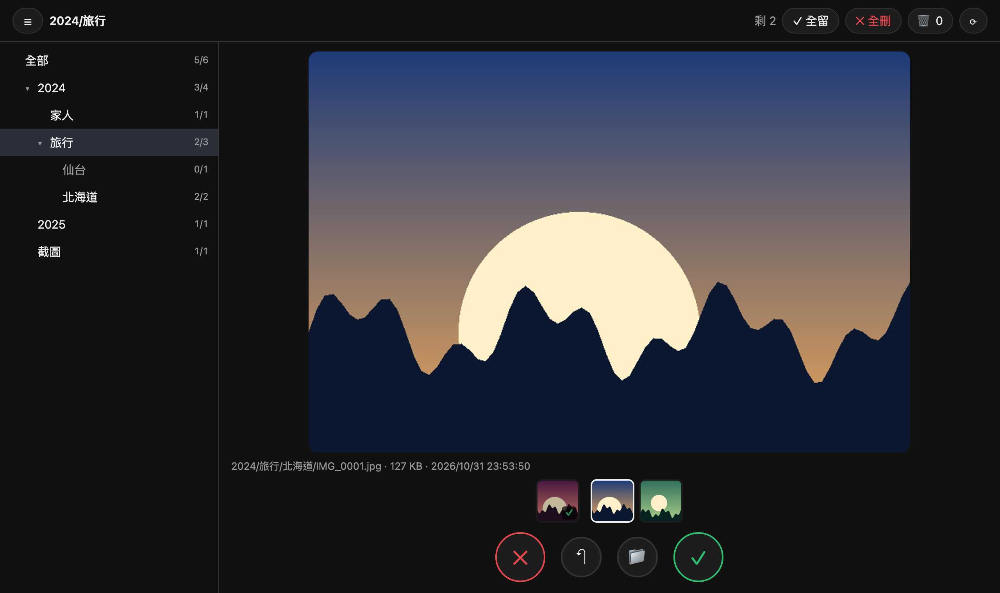
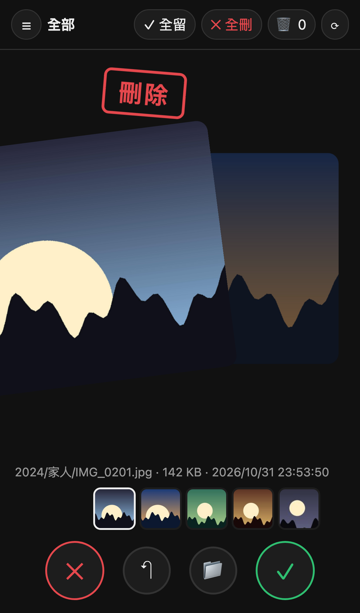

# swipe-sort

用滑動的方式整理 NAS 或任何資料夾裡的圖片和影片：**左滑刪除、右滑保留、上滑還原、下滑搬移**。也可以切到純瀏覽模式，只看不處理。

刪除時檔案不會真的消失，而是先移到垃圾桶，隨時可以救回來，最後再一次批次清掉。這是一個自己架設的網頁工具，手機和電腦都能用，不需要相簿系統，也不需要建立索引資料庫，直接讀資料夾就好。

<p align="center">
  
  
</p>

## 功能

- **只要指定一個父資料夾**，就會掃描底下所有子資料夾。左側的資料夾樹可以展開或收合，並顯示每個資料夾「待處理數／總數」，點一下就只整理那個資料夾（包含它的子資料夾）
- **四個方向的操作**

  | 動作 | 手機 | 鍵盤 | 按鈕 |
  |---|---|---|---|
  | 刪除（移到垃圾桶） | 左滑 | `←` | ✕ |
  | 保留 | 右滑 | `→` | ✓ |
  | 還原上一步 | 上滑 | `↑` / `U` / `Backspace` | ↶，或點縮圖列的上一張 |
  | 搬移到其他資料夾 | 下滑 | `↓` / `M` | 📁 |
  | 播放或暫停影片 | 點一下 | `Space` | |

- **純瀏覽模式**：按頂部的 👁 切換。可以前後翻看資料夾裡所有的檔案（包含已經保留的，會標上 ✓），不會做任何決定。左滑或 `→` 看下一張，右滑或 `←` 看上一張，也可以點縮圖直接跳過去。再按 ✋ 就回到整理模式
- **還原可以一直往回退**，保留、刪除、搬移都能撤回
- **整批處理**：「✓ 全留」或「✕ 全刪」會一次處理目前資料夾剩下的所有檔案，按一次還原就整批撤回
- **搬移**：可以篩選資料夾，最近用過的排在最前面。輸入不存在的路徑會自動建立資料夾。目標資料夾已經有同名檔案時，會自動改名，不會覆蓋
- **垃圾桶頁**：用縮圖列出已刪除的檔案，可以逐個還原、全部還原，或永久刪除（**只有這一步會真的刪檔**）
- **上下張預覽**：下方縮圖列會顯示上一張（標出剛才的決定）、目前這張和接下來 4 張，下一張也會預先載入，換張時不會閃
- **預覽圖**：大圖會先縮小再傳，支援 HEIC，並依照 EXIF 自動轉正
- **影片**：MP4、MOV、WebM 直接播放。AVI、MKV、WMV、MTS 等瀏覽器不能播的格式，會用 ffmpeg 轉成 H.264 MP4 預覽版（有 NVIDIA 顯卡時用 NVENC），原檔不動
- **進度會保存**：每個決定都會立刻寫進 SQLite，重新整理、換裝置或重開機都能接著做
- **自動略過系統檔**：隱藏檔、macOS 的 `._*`，以及 Synology 的 `@eaDir`、`#recycle`、`#snapshot`

## 需要的環境

- Python 3.10 以上（後端只用標準函式庫）
- 選用：`Pillow`、`pillow-heif`，用來產生圖片預覽和支援 HEIC
- 選用：`ffmpeg`，用來產生影片縮圖和轉檔

沒裝選用套件也能跑，只是圖片會直接傳原檔、看不了 HEIC，也播不了 AVI 這類影片。

## 快速開始

```sh
git clone https://github.com/zhChenOuO/swipe-sort.git
cd swipe-sort
python3 -m venv .venv
.venv/bin/pip install -r requirements.txt
.venv/bin/python -m swipesort --root /path/to/photos --port 8090
```

用瀏覽器打開 `http://localhost:8090`。

`--root` 可以是本機資料夾，也可以是已經掛載的 NAS（SMB 或 NFS）。建議在**跟 NAS 同一個區網、效能較好的機器**上執行，掃描和產生預覽都會快很多，遠端只需要傳縮小過的預覽圖。

## 設定

參數和環境變數擇一使用即可，參數的優先順序比較高。

| 環境變數 | 參數 | 預設值 | 說明 |
|---|---|---|---|
| `SWIPE_ROOT` | `--root` | （必填） | 要整理的父資料夾 |
| `SWIPE_DATA` | `--data` | `./data` | 資料庫（`swipe.db`）和預覽快取（`cache/`）放的位置 |
| `SWIPE_HOST` | `--host` | `0.0.0.0` | 監聽位址，只給本機用的話設成 `127.0.0.1` |
| `SWIPE_PORT` | `--port` | `8080` | |
| `SWIPE_PASSWORD` | | （空） | 有設定時會啟用 HTTP Basic 認證，帳號隨便填 |
| `SWIPE_VIDEO_SECONDS` | | `600` | 影片預覽只轉前面幾秒 |
| `SWIPE_TRANSCODE_JOBS` | | `2` | 同時最多轉幾支影片 |
| `SWIPE_LOG` | | （空） | 設定任意值就會印出每個 HTTP 請求 |

## 部署

### Linux：systemd 使用者服務

```ini
# ~/.config/systemd/user/swipe-sort.service
[Unit]
Description=swipe-sort
After=network-online.target

[Service]
WorkingDirectory=%h/swipe-sort
ExecStart=%h/swipe-sort/.venv/bin/python -m swipesort --root %h/nas --data %h/swipe-sort/data --port 8090
# Environment=SWIPE_PASSWORD=...  建議改用 EnvironmentFile 指向權限 600 的檔案
Restart=on-failure

[Install]
WantedBy=default.target
```

```sh
systemctl --user daemon-reload
systemctl --user enable --now swipe-sort
journalctl --user -u swipe-sort -f
```

如果要在沒登入時也繼續執行，記得執行 `loginctl enable-linger $USER`。

#### 用 SMB 掛載 NAS 的範例

```sh
mkdir -p ~/nas
printf 'username=<帳號>\npassword=<密碼>\n' > ~/.smb-nas && chmod 600 ~/.smb-nas
echo "//<NAS IP>/<共用資料夾> $HOME/nas cifs credentials=$HOME/.smb-nas,uid=$(id -u),gid=$(id -g),iocharset=utf8,vers=3.0,_netdev,x-systemd.automount 0 0" | sudo tee -a /etc/fstab
sudo systemctl daemon-reload && sudo mount ~/nas
```

### Docker／Synology Container Manager

1. 把這個 repo 放到 NAS 上，例如 `/volume1/docker/swipe-sort`
2. 修改 `docker-compose.yml`：
   - `volumes` 的 `/volume1/photo` 改成要整理的父資料夾
   - `user` 改成對這個資料夾有讀寫權限的帳號 `uid:gid`（SSH 進 NAS 執行 `id <帳號>` 查詢）
   - 如果要從外網連，記得設定 `SWIPE_PASSWORD`
3. 在 Container Manager → 專案 → 新增，選這個資料夾，然後建置並啟動
4. 用瀏覽器打開 `http://<NAS IP>:8080`

映像檔裡已經包含 ffmpeg，但容器裡沒有 GPU，所以影片轉檔會用 CPU。NAS 的 CPU 通常比較弱，轉 HEVC 會很慢。

## 運作方式

### 檔案會被怎麼處理

| 動作 | 對檔案做的事 |
|---|---|
| 保留 | 不動檔案，只記錄下來 |
| 刪除 | 搬到 `<root>/.swipe-trash/<原本的相對路徑>`。同一個磁碟區裡只是改名，幾乎不花時間，也不會多佔空間 |
| 搬移 | 搬到 `<root>/<目標資料夾>/<檔名>` |
| 還原 | 搬回原位。如果原位置已經有檔案，會停下來，不會覆蓋 |
| 永久刪除 | 真正刪除垃圾桶裡的檔案，**這一步無法還原** |

### 資料存在哪裡

```
data/
├── swipe.db          # 所有決定（SQLite）
└── cache/
    ├── xx/*.jpg      # 圖片預覽、影片縮圖
    └── video/xx/*.mp4  # 影片轉檔後的預覽版
```

`cache/` 可以隨時整個刪掉，需要時會重新產生。`swipe.db` 刪掉的話，進度會歸零，但垃圾桶裡的檔案還留在 `.swipe-trash/`，只能自己手動搬回去。

查詢進度的例子：

```sh
sqlite3 data/swipe.db "SELECT decision, COUNT(*) FROM decisions GROUP BY 1"
sqlite3 data/swipe.db "SELECT path, decision, datetime(at, 'unixepoch', 'localtime') FROM decisions ORDER BY seq DESC LIMIT 20"
```

`decisions` 資料表的欄位：

| 欄位 | 說明 |
|---|---|
| `path` | 原本的相對路徑 |
| `decision` | `keep`、`trash` 或 `move` |
| `trash_path` | 刪除時是垃圾桶裡的路徑，搬移時是新路徑 |
| `seq` | 還原的順序。整批操作共用同一個 `seq`，所以會整批撤回 |

### 影片轉檔

| 原始格式 | 處理方式 |
|---|---|
| MP4、MOV、M4V、WebM | 直接播放 |
| 其他外殼，影像已經是 H.264 | 只換成 MP4 外殼，幾秒內完成，畫質不變 |
| 其他（DivX/Xvid、HEVC、VP9…） | 轉成 720p H.264。依序嘗試 CUDA 解碼加 NVENC，失敗時改用 libx264 |

- 第一次看到某支影片時才會轉，背景預先載入的下一張也會觸發轉檔
- 轉檔失敗會留下 `.fail` 記號，之後不會重試。刪掉這個記號就會重新嘗試

## 注意事項

- **沒有設定密碼時，任何能連到這個連接埠的人，都能看到所有照片，也能刪除檔案。** 如果不是只在自己的區網裡用，請設定 `SWIPE_PASSWORD`，或者只監聽 `127.0.0.1` 再搭配 SSH 隧道。這裡的認證只是 HTTP Basic，要開放到外網的話，請在前面加一層 HTTPS 反向代理
- 決定是用相對路徑記錄的。如果在外部把檔案改名或搬走，按 ⟳ 重新掃描後，會被當成新檔案
- 如果手機或電腦有自動備份到 NAS 的資料夾，在這些資料夾裡刪除或搬移檔案，備份程式可能會重新上傳
- 搬到新建的資料夾後再還原，那個空資料夾會留著，不會自動刪除

## API

所有路徑都是相對於 `--root`，使用 `/` 分隔。

| 方法 | 路徑 | 說明 |
|---|---|---|
| GET | `/api/folders` | 資料夾清單和統計 |
| GET | `/api/queue?folder=&after=&limit=` | 待處理的檔案，依路徑排序。`after` 是分頁游標 |
| GET | `/api/preview?path=&size=&trash=1` | JPEG 預覽圖，影片會回傳縮圖 |
| GET | `/api/video?path=&trash=1` | 可以播放的影片，需要時會先轉檔。支援 Range |
| GET | `/api/file?path=&trash=1` | 原檔，支援 Range |
| GET | `/api/list?folder=&after=&limit=` | 瀏覽模式用，列出所有還在原位的檔案，附上 `decision` |
| GET | `/api/trash` | 垃圾桶清單 |
| POST | `/api/decide` | `{path, decision: keep\|trash\|move, target?}` |
| POST | `/api/decide-all` | `{folder, decision: keep\|trash}` |
| POST | `/api/undo` | 撤回最後一個決定，或最後一批 |
| POST | `/api/restore` | `{path}` 或 `{all: true}` |
| POST | `/api/purge` | `{confirm: "DELETE"}`，永久刪除垃圾桶 |
| POST | `/api/reset-kept` | `{folder}`，把「保留」清掉，讓這些檔案重新出現 |
| POST | `/api/rescan` | 重新掃描資料夾 |

## 開發

```
swipesort/
├── core.py        # 掃描、決定、垃圾桶、還原（不碰 HTTP）
├── server.py      # 標準函式庫的 HTTP 伺服器和 API
├── preview.py     # 圖片預覽、影片縮圖
├── transcode.py   # ffmpeg 影片轉檔
└── static/        # 前端（原生 HTML/CSS/JS，不需要打包）
tests/
```

```sh
python -m unittest discover -s tests -t .
```

沒裝 ffmpeg 時，影片轉檔的測試會自動跳過。
